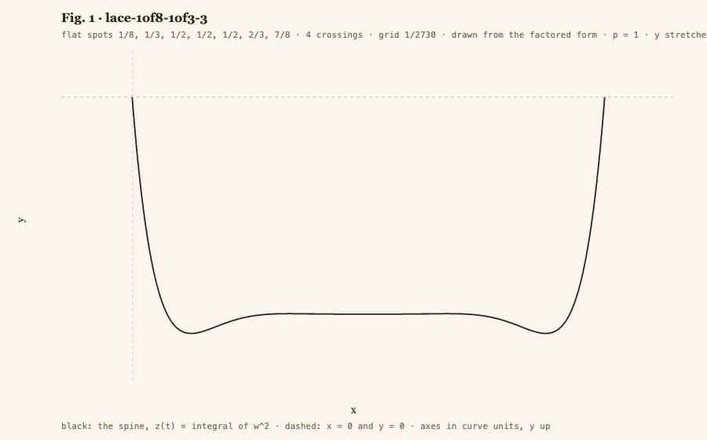

> **draft A** — a working draft, not a final text.

This page follows a single stored curve from its definition to its figure and
its checks. If you read one page to see how the project fits together, read this
one.

The curve is `lace-1of8-1of3-3`. Its record is
`curves/lace-1of8-1of3-3/curve.json`. In one line: **3 crossing pairs, grid
1/2730, arc 10.4114**.

## 1. The definition

The curve is written as the square of a complex polynomial. With

```
p(t) = 3 - 16t + 16t²
q(t) = -14 + 275t - 2081t² + 8158t³ - 18220t⁴ + 23416t⁵ - 16128t⁶ + 4608t⁷
w(t) = p(t) + i q(t)
```

the position is

```
z(t) = ∫ w(t)² dt
```

so the velocity is `w²` and its length is `|w|² = p² + q²`, which is a
polynomial in `t`. That is the whole trick: a polynomial length means the arc
length is a polynomial integral, and a polynomial integral of whole numbers is
exact.

The position rows, integrated term by term, are

```
x(t) = -187t + 3802t² - 133541/3 t³ + 686231/2 t⁴ - ... + 10616832t¹⁴ - 7077888/5 t¹⁵
y(t) = -84t + 1049t² - 21734/3 t³ + 31085t⁴ - ... + 73728/5 t¹⁰
```

The fractions are the whole story. A term `c·t^k` integrates to `c/(k+1)`, so a
denominator appears at every power.

## 2. The grid

The denominators above are **2, 3, 5, 7 and 13**. Their least common multiple is

```
2 × 3 × 5 × 7 × 13 = 2730
```

Multiply the whole position by 2730 and every coefficient is an integer. The
**grid is 1/2730**: the pitch the curve's points can land on. A grid of 1/2730
is cheap enough to store and to compare; a grid of 1/86,625,000,000,000 is not,
which is why the page refuses a tweak size of 1/3.

The code is `curve_lab/measure.py:grid()`. It squares the speed rows, divides
by the power plus one, and takes the least common multiple of the denominators.
There is one implementation, and every stored number comes from it.

## 3. The measures

| measure | value | how it is read |
|---|---|---|
| grid | 1/2730 | the common denominator of the position rows |
| arc | 28423/2730 = 10.4114 | the exact integral of `p² + q²` |
| chord | 7.3447 | the distance between the two ends |
| bend | 1.418 | arc over chord: 10.4114 / 7.3447 |
| crossings | 3 pairs | two parameters `t₁ < t₂` at the same place |
| flat spots | 1/8, 1/3, 1/2, 1/2, 1/2, 2/3, 7/8 | the roots of `q(t) = 0` |

The three crossing pairs are at

```
t 0.0449 and 0.9541   →  (-3.6550, -2.2032)
t 0.2227 and 0.2969   →  (-3.8034, -2.7551)
t 0.7021 and 0.7764   →  (-3.5407, -2.7551)
```

Three passes through one point would be three pairs at one place. Here the
three places are distinct. The number is **crossing pairs**, not meeting points.

## 4. Recompute it

```sh
.venv/bin/python - <<'PY'
import json, sys
sys.path.insert(0, "scripts")

from curve_lab import measure
from ph_crossings import self_crossings

record = json.load(open("curves/lace-1of8-1of3-3/curve.json"))
print("grid  ", measure.grid(record["speedX"], record["speedY"]))
print("arc   ", measure.arc_and_chord(record["speedX"], record["speedY"]))
print("pairs ", len(self_crossings(record["speedX"], record["speedY"])))
PY
```

```
grid   2730
arc    (Fraction(28423, 2730), (-7.344688644688644+0j), 1.417999...)
pairs  3
```

The three numbers on that output are the three in the record. If they differ,
the record is stale, and `scripts/exact_numbers.py --write` repairs the grid and
the bend.

## 5. Where the figure comes from

`curves/lace-1of8-1of3-3/figure.png` is drawn by the page itself
(`scripts/curve_png.mjs`), from the same record. `figure-exact.png` is the
factored drawing, which keeps a large row from collapsing to a flat line. The
copy below is the factored one, so this page can show it:



*Fig. E1. `lace-1of8-1of3-3` on grid 1/2730: 3 crossing pairs, bend 1.418. The
figure is a copy of `curves/lace-1of8-1of3-3/figure-exact.png`; the record is
the authority for the numbers.*

Positive y is up in the record. The SVG writer flips it once at output, because
SVG's y points down.

## 6. The checks

| claim | the check |
|---|---|
| grid and bend match the exact core | `scripts/exact_numbers.py` |
| crossing pairs match the router | `scripts/crossing_audit.py` |
| the record reads through one loader | `scripts/data_audit.py` |
| the page is rebuilt from its generator | the page's own test |
| a fixed fault stays fixed | `.venv/bin/python -m unittest tests.test_regressions` |

## What this page shows

A number in this project is a fraction or a count, produced by one function, and
reproduced by one command. The figure is a picture of the same record, not a
second source. That is what "exact" means here, and it is the standard every
page is held to.
