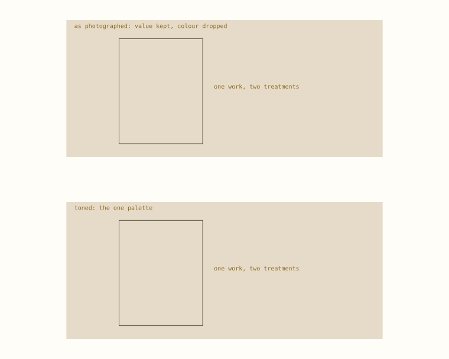
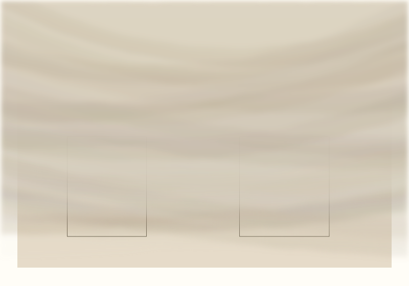
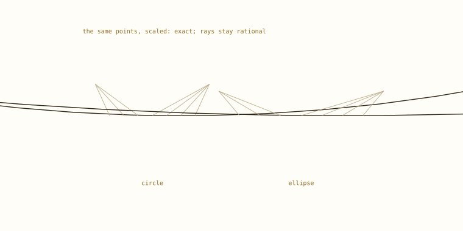

# A cloud, for veiling

The cathedral has no single artwork problem; it has one per piece. The proposal is a veil rather than a repair: tone the photographs into one palette of light tans and grays, and put a layered, semi-transparent cloud in front. The cloud is the constant; the works stay different behind it.

> The cloud is also a theological choice. At the Transfiguration, at the baptism, at the temple when Gabriel spoke, at Fatima, the cloud does not explain the action -- it shelters it. What is hidden stays God's to reveal.

| role | tone | use |
| --- | --- | --- |
| wall | #e6dbc9 | the constant ground |
| haze | #ded8cf | outer breath, alpha 0.14 |
| bank | #cfc9bf | the flat base, alpha 0.34 |
| billow | #ddd0bb | volume, alpha 0.46 |
| crown | #f2ead9 | lit tops, alpha 0.60 |
| shadow | #b7ad9d | under the mass, never black |


## 1. Tone first, then veil



*One photograph: value kept, colour dropped, then mapped onto the palette.*

Tone is the first half of the unification and the cloud is the second. The photograph here is `reference/IMG_5972.JPG`, reduced to luminance and mapped onto the ramp above; the value structure stays, the colour argument goes. Two works of different periods then sit in the same room before the cloud is even drawn. The cloud hides the remaining seams -- the edges, the varnish, the reproduction -- rather than the subjects.

This is deliberately unheroic: no restoration, no repainting, no claim that the works match. They do not, and the veil says so honestly by being visible.


## 2. The veil



*Four layers of billows over a toned statue and a toned fresco: the works stay legible, the edges soften.*

The cloud is built from **exact ellipses**. A circle is a chain with one triangle angle per chord; scaling it by two rational radii and turning it by whole triangle angles gives an ellipse whose every point is still rational. So each billow can be placed on the integer lattice, repeated, mirrored and stored without a float deciding its edge. What is not exact is the compositing: tone and transparency are design numbers, not geometry.

```text
layers   4   haze 0.14, bank 0.34, billow 0.46, crown 0.6
puffs    19  ellipses, tilted by whole triangle angles
edge     fractal displacement, optical not geometric
overlap  the sum does the softening
geometry exact; opacity and tone are choices
```

Two variants are worth keeping. A **cumulus** (above) has a flat base and a domed top. An **incense** cloud is taller, thinner and more transparent, with vertical drift; it is the better veil for a side chapel or a shrine, where the cloud should rise in front of the work rather than rest above it. Both are the same palette and the same ellipses -- only the layout and the opacities differ.


## 3. Circles, ellipses, parabolas, hyperbolas



*A circle and the same circle scaled: both exact, and the rays remain rational under the scale.*

Not all four are the same curve, and it matters which is which. The chain is built from whole triangle angles, so its exact members are the circle (constant turn), the straight line (zero turn), the quarter-turn corner, and the clothoid-like family where curvature grows linearly. A circle is exact. An ellipse is exact **as an affine image of a circle** -- scale x by one rational and y by another, and every point stays rational -- but it is not a Euclidean circle and its curvature is not a clothoid. A parabola and a hyperbola have no such rational affine origin here, and no linear-curvature parameterisation; they can only be approximated, to the lattice's resolution, and the error should be measured rather than assumed.

The constructive part is real: because the ellipse is a scaled circle, a circle with rays from its diameter scales into an ellipse with rays, exactly. That is how the second drawing was made -- same points, same rational slopes, one rational scale. For a sunburst, a rose-window basis, or a billow with ribs, that is enough. For a true parabola or hyperbola, use the float path and report the gap.


## 4. What this is not

This framework does not replace the clothoid engine, and it is not a subset of its curves. Bertolazzi gives real clothoids -- exact Fresnel geometry, many parameterisations, tolerances. The chain here is an Euler polygon whose *headings* match a clothoid at the nodes; its position is up to a chord away, and its curvature is a staircase. What it adds is the other column: rational points, rational slopes, exact joins and mirrors, and a known lattice. The caps in `out/caps` came from the engine and transfer here by quantising each chord's turn, with a measured gap. The honest architecture is: engine for the transcendental curve, chain for the exact plan, and a converter between them.


## Reproduce

```text
cd pythagorean-spiral
../.venv/bin/python scripts/cloud.py
../.venv/bin/python -m unittest discover -s tests -t .
```
