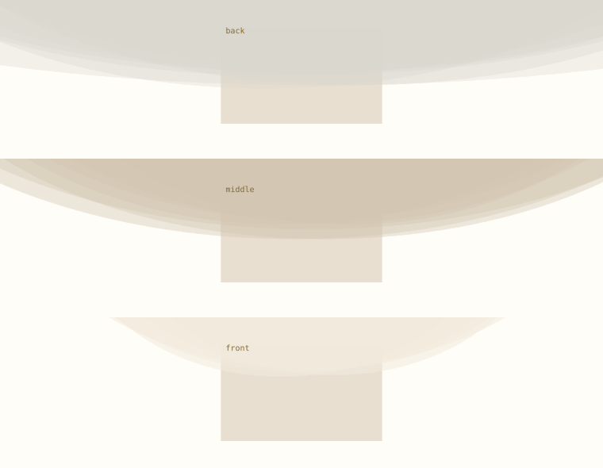

# A cloud, for veiling

The cathedral has no single artwork problem; it has one per piece. The proposal here is a veil rather than a repair: take the photographs, pull them into one palette of light tans and grays, and put a layered, semi-transparent cloud in front. The cloud is the constant; the works stay different behind it.

> The cloud is also a theological choice. At the Transfiguration, at the baptism, at the temple when Gabriel spoke, at Fatima, the cloud does not explain the action -- it shelters it. What is hidden stays God's to reveal.

This is a study, not a final asset: the geometry is exact, the opacity is optical, and both are computed below. The palette is deliberately narrow so that a photograph of any period can be toned into it.

| role | tone | use |
| --- | --- | --- |
| wall | #e9dfd0 | the constant ground |
| back billows | #d9d5ce | the bank, coolest |
| middle billows | #d3c6b2 | volume, warmer |
| front crowns | #f1e9dc | light, catching the top |
| shadow | #bcb7ae | the work behind, never black |


*Three layers of billows over a placeholder panel: the work stays legible, the edges soften.*

The cloud is built from **exact ellipses**. A circle is a chain with one triangle angle per chord; scaling it by two rational radii gives an ellipse whose every point is still rational. So each billow can be placed on the integer lattice, repeated, mirrored and stored without a float deciding its edge. What is not exact is the compositing: the tone and the transparency are design numbers, not geometry.


## 1. The layers



*Back, middle and front drawn alone. The veil is their sum, not one shape.*

```text
back     7 puffs, alpha 0.34, gray
middle   7 puffs, alpha 0.40, warm tan
front    5 puffs, alpha 0.52, light tan
overlap  the sum does the softening
edge     a billow is an ellipse, not a blur
```

Drawing the layers separately is the whole method: no single shape has to look like cloud. The overlap does, and the overlap is cheap to vary -- move a puff, resize it by a rational, change one opacity. The same palette then sits over every work in the building.


## 2. Circles, ellipses, parabolas, hyperbolas


*A circle and the same circle scaled: both exact, and the rays remain rational under the scale.*

Not all four are the same curve, and it matters which is which. The chain is built from whole triangle angles, so its exact members are the circle (constant turn), the straight line (zero turn), the quarter-turn corner, and the clothoid-like family where curvature grows linearly. A circle is exact. An ellipse is exact **as an affine image of a circle** -- scale x by one rational and y by another and every point stays rational -- but it is not a Euclidean circle and its curvature is not a clothoid. A parabola and a hyperbola have no such rational affine origin here, and no linear-curvature parameterisation; they can only be approximated, to the lattice's resolution, and the error should be measured, not assumed.

The constructive part is real: because the ellipse is a scaled circle, a circle with rays from its diameter scales into an ellipse with rays, exactly. That is how the second drawing was made -- same points, same rational slopes, one rational scale. For a sunburst, a rose window basis, or a billow with ribs, that is enough. For a true parabola or hyperbola, use the float path and report the gap.


## 3. What this is not

This framework does not replace the clothoid engine, and it is not a subset of its curves. Bertolazzi gives real clothoids -- exact Fresnel geometry, many parameterisations, tolerances. The chain here is an Euler polygon whose *headings* match a clothoid at the nodes; its position is up to a chord away, and its curvature is a staircase. What it adds is the other column: rational points, rational slopes, exact joins and mirrors, and a known lattice. The caps in `out/caps` came from the engine and transfer here by quantising each chord's turn, with a measured gap. The honest architecture is: engine for the transcendental curve, chain for the exact plan, and a converter between them.


## Reproduce

```text
cd pythagorean-spiral
../.venv/bin/python scripts/cloud.py
../.venv/bin/python -m unittest discover -s tests -t .
```
