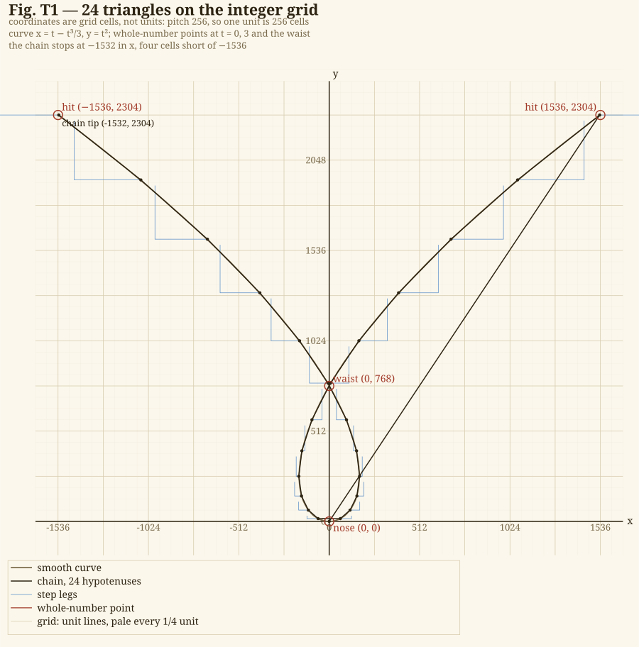

# Integer hits on the Tschirnhausen cubic

> Every comparison here is at twelve triangles per side, the same count for both methods. The constraint is where the curve meets whole-number points, not how fine the drawing is.


## 1. Where the curve hits whole numbers

The curve is x = t^2 and y = t - t^3/3. For a point to sit on the integer lattice, both coordinates must be whole numbers.

Take t as a fraction in lowest terms. Then x = t^2 is a whole number only if t is itself a whole number, because squaring a fraction in lowest terms cannot clear its denominator. Once t is whole, y = t - t^3/3 is whole exactly when 3 divides t. So the hits are the multiples of 3, and nothing else at rational t.

| t | x | y | arc length s | note |
|---|---|---|---|---|
| 0 | 0 | 0 | 0 | nose |
| 3 | 9 | -6 | 12 | first hit |
| 6 | 36 | -66 | 78 |  |
| 9 | 81 | -234 | 252 |  |
| 12 | 144 | -564 | 588 |  |
| 15 | 225 | -1110 | 1140 |  |

The curve is even in x and odd in y, so each hit (x, y) has a mirror (x, -y). One more whole-number point exists: the waist. y = 0 at t = plus or minus the square root of 3, which gives (3, 0). That parameter is not a fraction, so no chain built at fractional steps can land on it.


## 2. The grid exists to clear fractions

A fractional coordinate is not a failure. Pick a pitch that is a multiple of the denominators and the point lands on a whole cell: that is what the pitch is for. 144/25 of a unit is 2880 cells at pitch 500.

| stop t | x | y | the point, in cells | smallest pitch for the curve | smallest pitch for every chain side |
|---|---|---|---|---|---|
| 2 | 4 | -2/3 | (12, -2) | 3 | 864 |
| 21/10 | 441/100 | -987/1000 | (4410, -987) | 1000 | 256000 |
| 12/5 | 144/25 | -276/125 | (720, -276) | 125 | 500 |
| 5/2 | 25/4 | -65/24 | (150, -65) | 24 | 55296 |
| 3 | 9 | -6 | (9, -6) | 1 | 256 |
| 24/5 | 576/25 | -4008/125 | (2880, -4008) | 125 | 125 |
| 4 | 16 | -52/3 | (48, -52) | 3 | 108 |

All of these are exact. t = 3 is singled out only because it needs no scaling at all, not because the others fail. The chain needs a larger pitch than the curve at every stop, because each side has to be whole as well as each vertex.


## 3. Twelve triangles, both methods

Midpoint chain: each step is evaluated at the middle of the step, which is what makes the step sides exact whole numbers after scaling. Chordal: the nodes sit exactly on the curve and the segments are straight joins, so the node positions are exact but the side lengths are square roots.

| stopping t | step width | pitch | midpoint tip y | gap | x exact? | chordal tip | midpoint length | chordal length | exact length |
|---|---|---|---|---|---|---|---|---|---|
| 2 | 1/6 | 864 | -0.662037 | 0.004630 | yes | (4.000, -0.667) | 4.662037 | 4.661542 | 4.666667 |
| 12/5 | 1/5 | 500 | -2.200000 | 0.008000 | yes | (5.760, -2.208) | 7.000000 | 7.000163 | 7.008000 |
| 5/2 | 5/24 | 55296 | -2.699291 | 0.009042 | yes | (6.250, -2.708) | 7.699291 | 7.699726 | 7.708333 |
| 3 | 1/4 | 256 | -5.984375 | 0.015625 | yes | (9.000, -6.000) | 11.984375 | 11.986998 | 12.000000 |
| 4 | 1/3 | 108 | -17.296296 | 0.037037 | yes | (16.000, -17.333) | 25.296296 | 25.308812 | 25.333333 |

At twelve triangles the chordal path lands on the whole-number point exactly, at t = 3 giving (9, -6). The midpoint chain stops 1/64 short of it in y. At that same stop chordal is also the closer of the two on total length, 11.986998 against 11.984375 and an exact 12; further in, at t = 2.4, the two swap and the midpoint chain is closer by a hair. The midpoint chain's steady advantage is a different one: every side is an exact whole-number triple, so the path can be laid out with no square roots anywhere.


## 4. The twelve triangles at t = 3

Step width 1/4, pitch 256 cells per unit. The sides, in cells and as reduced triples:

| step | middle t | dx | dy | ds | reduced triple |
|---|---|---|---|---|---|
| 1 | 0.12 | 16 | 63 | 65 | (16, 63, 65) |
| 2 | 0.38 | 48 | 55 | 73 | (48, 55, 73) |
| 3 | 0.62 | 80 | 39 | 89 | (80, 39, 89) |
| 4 | 0.88 | 112 | 15 | 113 | (112, 15, 113) |
| 5 | 1.12 | 144 | -17 | 145 | (144, -17, 145) |
| 6 | 1.38 | 176 | -57 | 185 | (176, -57, 185) |
| 7 | 1.62 | 208 | -105 | 233 | (208, -105, 233) |
| 8 | 1.88 | 240 | -161 | 289 | (240, -161, 289) |
| 9 | 2.12 | 272 | -225 | 353 | (272, -225, 353) |
| 10 | 2.38 | 304 | -297 | 425 | (304, -297, 425) |
| 11 | 2.62 | 336 | -377 | 505 | (336, -377, 505) |
| 12 | 2.88 | 368 | -465 | 593 | (368, -465, 593) |

The last vertex is (9, -383/64), against the curve's (9, -6): short by 1/64 in y, exact in x. The x coordinate is exact for every count, because the along speed is linear and the midpoint rule integrates a linear function exactly.


## 5. How the pitch was chosen

The pitch depends only on the step width, which is the stopping point divided by the triangle count. At twelve triangles the step width is t/12, so the stopping point alone decides the pitch:

| stopping t | step width | pitch | why |
|---|---|---|---|
| 2 | 1/6 | 864 | denominator 6 |
| 2.1 | 7/40 | 256000 | denominator 40, ugly |
| 2.4 | 1/5 | 500 | denominator 5 |
| 2.5 | 5/24 | 55296 | denominator 24, numerator odd |
| 3 | 1/4 | 256 | denominator 4 |
| 4 | 1/3 | 108 | denominator 3 |

That table is a single rule. Write the step width as a fraction in lowest terms and look at its bottom number, call it q, and its top number:

```text
pitch = q cubed
pitch = 4 times q cubed    when the top number is odd
```

So the smallest pitch comes from the smallest denominator, and the factor of 4 disappears when the top number is even. Checked as an exact equality on twelve hundred combinations of stopping point and count.

The worked example that started this: twelve triangles per side out to t = 4. The step width is 4/12 = 1/3, the denominator is 3, so the pitch is 4 x 27 = 108. It is small because the step is coarse: twelve triangles across four units is a big step, and a big step has a small denominator. At t = 3 the same count gives a step width of 1/4 and a pitch of 256; at t = 2.4 it gives 1/5 and 500. The count is fixed at twelve, so the stopping point is the only lever you have.


## 6. The glyph at t = 3, in whole units

| feature | value |
|---|---|
| nose | (0, 0) |
| waist | (3, 0), reached at t = plus or minus the square root of 3 |
| tips | (9, -6) and (9, 6) |
| body length | 3 |
| tail span | 6, exactly twice the body |
| arc length, one side | 12 |
| full length, both sides | 24 |

This is the 'double the inner shape' proportion, measured along the axis, and it needs no scaling and no irrational number. The arc-length ratio is larger, 3.46, because the tail is thin and long. The figure shows the two sides at twelve triangles, with the whole-number points ringed.



A caution about the figure: the chain's last vertex sits at (9, -5.984375), just inside the ring at (9, -6). That gap is the 1/64, and it is the whole story of this document.


## 7. Checks and reproduce

Equality tests run whenever this document is generated. A failure means the document is wrong, not the numbers.

- PASS -- t = 3 gives (9, -6) and length 12 exactly
- PASS -- 2.4, 2.5, 12/5 and 2.1 all have non-whole rises
- PASS -- twelve triangles at t = 4 gives pitch 108
- PASS -- twelve triangles at t = 3 gives pitch 256
- PASS -- twelve triangles at t = 2.5 gives pitch 55296
- PASS -- midpoint gap is 1/64 at t = 3
- PASS -- chordal lands on (9, -6) at t = 3
- PASS -- first triangle at t = 3 is (16, 63, 65)
```text
.venv/bin/python tph_tri_chain/chain.py        # every table, exact
.venv/bin/python tph_tri_chain/glyph.py        # figure and csv
.venv/bin/python tph_tri_chain/make_results.py # this document
```

y is up, as the curve is. The SVG writer flips y once, in fy().

