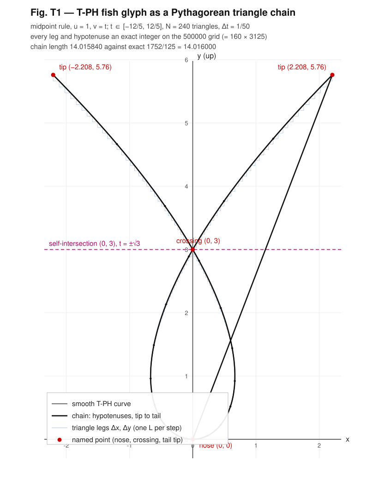

# T-PH fish glyph as a Pythagorean triangle chain

> Working result, not yet documentation. Held in tph_tri_chain/ so it stays separable from curve_lab/ph_hermite. Promote to docs/ only after the operator accepts the grid correction in section 10.


## 1. What this is and is not

This is the discrete midpoint chain of the Tschirnhausen cubic Pythagorean-hodograph curve. It is not a Bezier curve, not a spline, and not a generic cubic: no control polygon, basis function, knot vector or de Casteljau step appears in it. The curve is defined only by its two generator polynomials.


## 2. The curve, exactly

Generators u(t) = 1, v(t) = t. Everything below follows from those two polynomials.

| quantity | exact expression | value at t = 12/5 |
|---|---|---|
| x'(t) | 1 - t^2 | -4.760000 |
| y'(t) | 2t | 4.800000 |
| sigma(t), the speed | 1 + t^2 | 6.760000 |
| x(t) | t - t^3/3 | -2.208000 |
| y(t) | t^2 | 5.760000 |
| s(t) | t + t^3/3 | 7.008000 |


## 3. Midpoint quadrature, and why the triple is exact

[t0, t1] is split into N equal steps of width dt = (t1 - t0)/N. Each step is sampled at its midpoint t_i = t0 + (i + 1/2)dt, never at an endpoint.

```text
dx_i = (1 - t_i^2) * dt
dy_i = (2 * t_i)   * dt
ds_i = (1 + t_i^2) * dt
```

With u = 1 and v = t_i those three values are (u^2 - v^2)dt, (2uv)dt and (u^2 + v^2)dt. Expanding gives (u^2 - v^2)^2 + (2uv)^2 = (u^2 + v^2)^2 identically, so every step is a right triangle with an exact rational hypotenuse. The identity is tested as equality of Fractions in chain.py, not to a tolerance.

Midpoint sampling also makes the y coordinates exact for any N: sum of 2t_i dt telescopes to t_max^2. Only x carries quadrature error.


## 4. Worked example: [0, 2] in four steps

The whole four-triangle chain is exact on the integer grid 32. Legs, hypotenuses and nodes:

| i | midpoint t | dx | dy | ds | node x | node y |
|---|---|---|---|---|---|---|
| 0 | 0.250000 | 15 | 8 | 17 | 0.468750 | 0.250000 |
| 1 | 0.750000 | 7 | 24 | 25 | 0.687500 | 1.000000 |
| 2 | 1.250000 | -9 | 40 | 41 | 0.406250 | 2.250000 |
| 3 | 1.750000 | -33 | 56 | 65 | -0.625000 | 4.000000 |

Primitive triples, in order: (15, 8, 17), (7, 24, 25), (-9, 40, 41), (-33, 56, 65).

End point (-0.625, 4.000) against exact (-0.666667, 4.000); chain length 37/8 = 4.625000 against exact 14/3 = 4.666667. Length error -0.89 percent at four triangles.


## 5. Domain, symmetry, and where the loop closes

x(-t) = -x(t) and y(-t) = y(t), so the branch over [0, t_max] is half the glyph; the other half is the reflection x -> -x with y unchanged. The self-intersection is where x(t) = 0, i.e. t = sqrt(3) = 1.732051, at the point (0, 3). The closed loop has exact length 4*sqrt(3) = 6.928203.

A discrete chain does not hit (0, 3) exactly; it passes near it. At the step count used below the nearest node is about 0.028 away in y.


## 6. Coordinate table, [0, 2], N = 25

Exact integer grid 15625. dx, dy, ds are counts of 1/15625; x, y are the cumulative node.

| i | midpoint t | dx | dy | ds | node x | node y |
|---|---|---|---|---|---|---|
| 0 | 0.040000 | 1248 | 100 | 1252 | 0.079872 | 0.006400 |
| 1 | 0.120000 | 1232 | 300 | 1268 | 0.158720 | 0.025600 |
| 2 | 0.200000 | 1200 | 500 | 1300 | 0.235520 | 0.057600 |
| 3 | 0.280000 | 1152 | 700 | 1348 | 0.309248 | 0.102400 |
| 4 | 0.360000 | 1088 | 900 | 1412 | 0.378880 | 0.160000 |
| 5 | 0.440000 | 1008 | 1100 | 1492 | 0.443392 | 0.230400 |
| 6 | 0.520000 | 912 | 1300 | 1588 | 0.501760 | 0.313600 |
| 7 | 0.600000 | 800 | 1500 | 1700 | 0.552960 | 0.409600 |
| 8 | 0.680000 | 672 | 1700 | 1828 | 0.595968 | 0.518400 |
| 9 | 0.760000 | 528 | 1900 | 1972 | 0.629760 | 0.640000 |
| 10 | 0.840000 | 368 | 2100 | 2132 | 0.653312 | 0.774400 |
| 11 | 0.920000 | 192 | 2300 | 2308 | 0.665600 | 0.921600 |
| 12 | 1.000000 | 0 | 2500 | 2500 | 0.665600 | 1.081600 |
| 13 | 1.080000 | -208 | 2700 | 2708 | 0.652288 | 1.254400 |
| 14 | 1.160000 | -432 | 2900 | 2932 | 0.624640 | 1.440000 |
| 15 | 1.240000 | -672 | 3100 | 3172 | 0.581632 | 1.638400 |
| 16 | 1.320000 | -928 | 3300 | 3428 | 0.522240 | 1.849600 |
| 17 | 1.400000 | -1200 | 3500 | 3700 | 0.445440 | 2.073600 |
| 18 | 1.480000 | -1488 | 3700 | 3988 | 0.350208 | 2.310400 |
| 19 | 1.560000 | -1792 | 3900 | 4292 | 0.235520 | 2.560000 |
| 20 | 1.640000 | -2112 | 4100 | 4612 | 0.100352 | 2.822400 |
| 21 | 1.720000 | -2448 | 4300 | 4948 | -0.056320 | 3.097600 |
| 22 | 1.800000 | -2800 | 4500 | 5300 | -0.235520 | 3.385600 |
| 23 | 1.880000 | -3168 | 4700 | 5668 | -0.438272 | 3.686400 |
| 24 | 1.960000 | -3552 | 4900 | 6052 | -0.665600 | 4.000000 |

End (-0.665600, 4.000000), length 4.665600. The first five primitive triples are (312, 25, 313), (308, 75, 317), (12, 5, 13), (288, 175, 337), (272, 225, 353).


## 7. The fish glyph: [0, 12/5], N = 120 per branch

Branch table. Step width dt = 1/50, exact grid 500000 = 160/1 x 3125. The mirrored branch reuses these triples with dx negated, giving 240 triangles in total.

| i | midpoint t | dx | dy | ds | node x | node y |
|---|---|---|---|---|---|---|
| 0 | 0.010000 | 9999 | 200 | 10001 | 0.019998 | 0.000400 |
| 1 | 0.030000 | 9991 | 600 | 10009 | 0.039980 | 0.001600 |
| 2 | 0.050000 | 9975 | 1000 | 10025 | 0.059930 | 0.003600 |
| 3 | 0.070000 | 9951 | 1400 | 10049 | 0.079832 | 0.006400 |
| 4 | 0.090000 | 9919 | 1800 | 10081 | 0.099670 | 0.010000 |
| 5 | 0.110000 | 9879 | 2200 | 10121 | 0.119428 | 0.014400 |
| 6 | 0.130000 | 9831 | 2600 | 10169 | 0.139090 | 0.019600 |
| 7 | 0.150000 | 9775 | 3000 | 10225 | 0.158640 | 0.025600 |
| 8 | 0.170000 | 9711 | 3400 | 10289 | 0.178062 | 0.032400 |
| 9 | 0.190000 | 9639 | 3800 | 10361 | 0.197340 | 0.040000 |
| 10 | 0.210000 | 9559 | 4200 | 10441 | 0.216458 | 0.048400 |
| 11 | 0.230000 | 9471 | 4600 | 10529 | 0.235400 | 0.057600 |
| 12 | 0.250000 | 9375 | 5000 | 10625 | 0.254150 | 0.067600 |
| 13 | 0.270000 | 9271 | 5400 | 10729 | 0.272692 | 0.078400 |
| 14 | 0.290000 | 9159 | 5800 | 10841 | 0.291010 | 0.090000 |
| 15 | 0.310000 | 9039 | 6200 | 10961 | 0.309088 | 0.102400 |
| 16 | 0.330000 | 8911 | 6600 | 11089 | 0.326910 | 0.115600 |
| 17 | 0.350000 | 8775 | 7000 | 11225 | 0.344460 | 0.129600 |
| 18 | 0.370000 | 8631 | 7400 | 11369 | 0.361722 | 0.144400 |
| 19 | 0.390000 | 8479 | 7800 | 11521 | 0.378680 | 0.160000 |
| 20 | 0.410000 | 8319 | 8200 | 11681 | 0.395318 | 0.176400 |
| 21 | 0.430000 | 8151 | 8600 | 11849 | 0.411620 | 0.193600 |
| 22 | 0.450000 | 7975 | 9000 | 12025 | 0.427570 | 0.211600 |
| 23 | 0.470000 | 7791 | 9400 | 12209 | 0.443152 | 0.230400 |
| 24 | 0.490000 | 7599 | 9800 | 12401 | 0.458350 | 0.250000 |
| 25 | 0.510000 | 7399 | 10200 | 12601 | 0.473148 | 0.270400 |
| 26 | 0.530000 | 7191 | 10600 | 12809 | 0.487530 | 0.291600 |
| 27 | 0.550000 | 6975 | 11000 | 13025 | 0.501480 | 0.313600 |
| 28 | 0.570000 | 6751 | 11400 | 13249 | 0.514982 | 0.336400 |
| 29 | 0.590000 | 6519 | 11800 | 13481 | 0.528020 | 0.360000 |
| 30 | 0.610000 | 6279 | 12200 | 13721 | 0.540578 | 0.384400 |
| 31 | 0.630000 | 6031 | 12600 | 13969 | 0.552640 | 0.409600 |
| 32 | 0.650000 | 5775 | 13000 | 14225 | 0.564190 | 0.435600 |
| 33 | 0.670000 | 5511 | 13400 | 14489 | 0.575212 | 0.462400 |
| 34 | 0.690000 | 5239 | 13800 | 14761 | 0.585690 | 0.490000 |
| 35 | 0.710000 | 4959 | 14200 | 15041 | 0.595608 | 0.518400 |
| 36 | 0.730000 | 4671 | 14600 | 15329 | 0.604950 | 0.547600 |
| 37 | 0.750000 | 4375 | 15000 | 15625 | 0.613700 | 0.577600 |
| 38 | 0.770000 | 4071 | 15400 | 15929 | 0.621842 | 0.608400 |
| 39 | 0.790000 | 3759 | 15800 | 16241 | 0.629360 | 0.640000 |
| 40 | 0.810000 | 3439 | 16200 | 16561 | 0.636238 | 0.672400 |
| 41 | 0.830000 | 3111 | 16600 | 16889 | 0.642460 | 0.705600 |
| 42 | 0.850000 | 2775 | 17000 | 17225 | 0.648010 | 0.739600 |
| 43 | 0.870000 | 2431 | 17400 | 17569 | 0.652872 | 0.774400 |
| 44 | 0.890000 | 2079 | 17800 | 17921 | 0.657030 | 0.810000 |
| 45 | 0.910000 | 1719 | 18200 | 18281 | 0.660468 | 0.846400 |
| 46 | 0.930000 | 1351 | 18600 | 18649 | 0.663170 | 0.883600 |
| 47 | 0.950000 | 975 | 19000 | 19025 | 0.665120 | 0.921600 |
| 48 | 0.970000 | 591 | 19400 | 19409 | 0.666302 | 0.960400 |
| 49 | 0.990000 | 199 | 19800 | 19801 | 0.666700 | 1.000000 |
| 50 | 1.010000 | -201 | 20200 | 20201 | 0.666298 | 1.040400 |
| 51 | 1.030000 | -609 | 20600 | 20609 | 0.665080 | 1.081600 |
| 52 | 1.050000 | -1025 | 21000 | 21025 | 0.663030 | 1.123600 |
| 53 | 1.070000 | -1449 | 21400 | 21449 | 0.660132 | 1.166400 |
| 54 | 1.090000 | -1881 | 21800 | 21881 | 0.656370 | 1.210000 |
| 55 | 1.110000 | -2321 | 22200 | 22321 | 0.651728 | 1.254400 |
| 56 | 1.130000 | -2769 | 22600 | 22769 | 0.646190 | 1.299600 |
| 57 | 1.150000 | -3225 | 23000 | 23225 | 0.639740 | 1.345600 |
| 58 | 1.170000 | -3689 | 23400 | 23689 | 0.632362 | 1.392400 |
| 59 | 1.190000 | -4161 | 23800 | 24161 | 0.624040 | 1.440000 |
| 60 | 1.210000 | -4641 | 24200 | 24641 | 0.614758 | 1.488400 |
| 61 | 1.230000 | -5129 | 24600 | 25129 | 0.604500 | 1.537600 |
| 62 | 1.250000 | -5625 | 25000 | 25625 | 0.593250 | 1.587600 |
| 63 | 1.270000 | -6129 | 25400 | 26129 | 0.580992 | 1.638400 |
| 64 | 1.290000 | -6641 | 25800 | 26641 | 0.567710 | 1.690000 |
| 65 | 1.310000 | -7161 | 26200 | 27161 | 0.553388 | 1.742400 |
| 66 | 1.330000 | -7689 | 26600 | 27689 | 0.538010 | 1.795600 |
| 67 | 1.350000 | -8225 | 27000 | 28225 | 0.521560 | 1.849600 |
| 68 | 1.370000 | -8769 | 27400 | 28769 | 0.504022 | 1.904400 |
| 69 | 1.390000 | -9321 | 27800 | 29321 | 0.485380 | 1.960000 |
| 70 | 1.410000 | -9881 | 28200 | 29881 | 0.465618 | 2.016400 |
| 71 | 1.430000 | -10449 | 28600 | 30449 | 0.444720 | 2.073600 |
| 72 | 1.450000 | -11025 | 29000 | 31025 | 0.422670 | 2.131600 |
| 73 | 1.470000 | -11609 | 29400 | 31609 | 0.399452 | 2.190400 |
| 74 | 1.490000 | -12201 | 29800 | 32201 | 0.375050 | 2.250000 |
| 75 | 1.510000 | -12801 | 30200 | 32801 | 0.349448 | 2.310400 |
| 76 | 1.530000 | -13409 | 30600 | 33409 | 0.322630 | 2.371600 |
| 77 | 1.550000 | -14025 | 31000 | 34025 | 0.294580 | 2.433600 |
| 78 | 1.570000 | -14649 | 31400 | 34649 | 0.265282 | 2.496400 |
| 79 | 1.590000 | -15281 | 31800 | 35281 | 0.234720 | 2.560000 |
| 80 | 1.610000 | -15921 | 32200 | 35921 | 0.202878 | 2.624400 |
| 81 | 1.630000 | -16569 | 32600 | 36569 | 0.169740 | 2.689600 |
| 82 | 1.650000 | -17225 | 33000 | 37225 | 0.135290 | 2.755600 |
| 83 | 1.670000 | -17889 | 33400 | 37889 | 0.099512 | 2.822400 |
| 84 | 1.690000 | -18561 | 33800 | 38561 | 0.062390 | 2.890000 |
| 85 | 1.710000 | -19241 | 34200 | 39241 | 0.023908 | 2.958400 |
| 86 | 1.730000 | -19929 | 34600 | 39929 | -0.015950 | 3.027600 |
| 87 | 1.750000 | -20625 | 35000 | 40625 | -0.057200 | 3.097600 |
| 88 | 1.770000 | -21329 | 35400 | 41329 | -0.099858 | 3.168400 |
| 89 | 1.790000 | -22041 | 35800 | 42041 | -0.143940 | 3.240000 |
| 90 | 1.810000 | -22761 | 36200 | 42761 | -0.189462 | 3.312400 |
| 91 | 1.830000 | -23489 | 36600 | 43489 | -0.236440 | 3.385600 |
| 92 | 1.850000 | -24225 | 37000 | 44225 | -0.284890 | 3.459600 |
| 93 | 1.870000 | -24969 | 37400 | 44969 | -0.334828 | 3.534400 |
| 94 | 1.890000 | -25721 | 37800 | 45721 | -0.386270 | 3.610000 |
| 95 | 1.910000 | -26481 | 38200 | 46481 | -0.439232 | 3.686400 |
| 96 | 1.930000 | -27249 | 38600 | 47249 | -0.493730 | 3.763600 |
| 97 | 1.950000 | -28025 | 39000 | 48025 | -0.549780 | 3.841600 |
| 98 | 1.970000 | -28809 | 39400 | 48809 | -0.607398 | 3.920400 |
| 99 | 1.990000 | -29601 | 39800 | 49601 | -0.666600 | 4.000000 |
| 100 | 2.010000 | -30401 | 40200 | 50401 | -0.727402 | 4.080400 |
| 101 | 2.030000 | -31209 | 40600 | 51209 | -0.789820 | 4.161600 |
| 102 | 2.050000 | -32025 | 41000 | 52025 | -0.853870 | 4.243600 |
| 103 | 2.070000 | -32849 | 41400 | 52849 | -0.919568 | 4.326400 |
| 104 | 2.090000 | -33681 | 41800 | 53681 | -0.986930 | 4.410000 |
| 105 | 2.110000 | -34521 | 42200 | 54521 | -1.055972 | 4.494400 |
| 106 | 2.130000 | -35369 | 42600 | 55369 | -1.126710 | 4.579600 |
| 107 | 2.150000 | -36225 | 43000 | 56225 | -1.199160 | 4.665600 |
| 108 | 2.170000 | -37089 | 43400 | 57089 | -1.273338 | 4.752400 |
| 109 | 2.190000 | -37961 | 43800 | 57961 | -1.349260 | 4.840000 |
| 110 | 2.210000 | -38841 | 44200 | 58841 | -1.426942 | 4.928400 |
| 111 | 2.230000 | -39729 | 44600 | 59729 | -1.506400 | 5.017600 |
| 112 | 2.250000 | -40625 | 45000 | 60625 | -1.587650 | 5.107600 |
| 113 | 2.270000 | -41529 | 45400 | 61529 | -1.670708 | 5.198400 |
| 114 | 2.290000 | -42441 | 45800 | 62441 | -1.755590 | 5.290000 |
| 115 | 2.310000 | -43361 | 46200 | 63361 | -1.842312 | 5.382400 |
| 116 | 2.330000 | -44289 | 46600 | 64289 | -1.930890 | 5.475600 |
| 117 | 2.350000 | -45225 | 47000 | 65225 | -2.021340 | 5.569600 |
| 118 | 2.370000 | -46169 | 47400 | 66169 | -2.113678 | 5.664400 |
| 119 | 2.390000 | -47121 | 47800 | 67121 | -2.207920 | 5.760000 |

| measure | value |
|---|---|
| triangles, both branches | 240 |
| tail tip, exact | (-2.208000, 5.760000) |
| tail tip, chain | (--2.207920, 5.760000) |
| chain length | 87599/6250 = 14.015840 |
| exact length | 1752/125 = 14.016000 |
| length error | -1.600e-04 |
| ratio to inner loop | 2.023 |
| far tip on grid (t = 12/5) | -1103960 / 2880000 |



The tail height 144/25 = 5.76 is exact for every N, because midpoint quadrature is exact on the linear y'(t). The tail is 2.02 times the inner loop length, so the glyph is close to double the inner shape, as intended.

Artifacts: out/fish-t24.csv holds all 240 steps as integers, out/fish-t24.svg is the labelled figure.


## 8. Where to stop

The loop closes at t = sqrt(3). Past it there are three natural stops:

| t_max | tail tip | full length | ratio | exact grid |
|---|---|---|---|---|
| 5/2 | (-2.7083, 6.2500) | 15.416500 | 2.225 | 500000 |
| 12/5 | (-2.2080, 5.7600) | 14.015840 | 2.023 | 500000 |
| sqrt6 | (-2.4495, 6.0000) | 14.696938 | 2.121 | none, t irrational |

12/5 is the grid-exact choice: 2.023 times the loop length with every step on one integer grid. sqrt(6) is the geometric choice, tail height exactly double the loop height, but t is irrational so no rational chain ends there. 5/2 is the cleanest division but overshoots to 2.22 times.


## 9. Accuracy and grid cost

Error falls as 1/N^2, as midpoint quadrature predicts. The exact integer grid grows as N^3, so doubling the triangle count multiplies the grid by eight. The grid is not a fixed canvas you can keep adding triangles to.

| t_max | N | dt | grid | fits 3125 | half-length error |
|---|---|---|---|---|---|
| 12/5 | 6 | 2/5 | 125 | yes | -3.200e-02 |
| 12/5 | 12 | 1/5 | 500 | no | -8.000e-03 |
| 12/5 | 24 | 1/10 | 4000 | no | -2.000e-03 |
| 12/5 | 30 | 2/25 | 15625 | no | -1.280e-03 |
| 12/5 | 60 | 1/25 | 62500 | no | -3.200e-04 |
| 12/5 | 120 | 1/50 | 500000 | no | -8.000e-05 |
| 12/5 | 240 | 1/100 | 4000000 | no | -2.000e-05 |
| 5/2 | 5 | 1/2 | 32 | no | -5.208e-02 |
| 5/2 | 10 | 1/4 | 256 | no | -1.302e-02 |
| 5/2 | 25 | 1/10 | 4000 | no | -2.083e-03 |
| 5/2 | 50 | 1/20 | 32000 | no | -5.208e-04 |
| 5/2 | 125 | 1/50 | 500000 | no | -8.333e-05 |


## 10. The 3125 grid: correction

The exact integer grid depends only on the step width dt = (t1 - t0)/N, not on t_max or N separately. Write dt = c/q in lowest terms and let p = 2i + 1, always odd; then t_i = p c / (2q) and

```text
grid = q^3        when c is even
grid = 4 * q^3    when c is odd
```

Verified as exact equality on 1200 (t_max, N) pairs across ten rational t_max. The 4 is the midpoint half-step: when c is odd, 4q^2 - p^2 c^2 is odd, so the factor 4 can never cancel. An even numerator cancels it completely, and that is the only route to an odd grid.

| dt | grid | triangles per branch at t = 12/5 | note |
|---|---|---|---|
| 2/5 | 125 | 6 | only exact option on 3125 |
| 4/5 | 125 | 3 | coarser, still on 3125 |
| 1/5 | 500 | 12 | odd numerator, factor 4 returns |
| 2/25 | 15625 | 30 | 5 x 3125, even numerator |
| 1/25 | 62500 | 60 | odd numerator |
| 1/50 | 500000 | 120 | current figure, 160 x 3125 |

Because 3125 = 5^5 is odd, it can only appear when c is even and q^3 divides it: q = 5, so dt = 2/5 or 4/5, i.e. N = 5 t_max / 2. At dt = 2/5 the fish gets 6 triangles per branch. That is the trade: the 3125 canvas buys six triangles, not a hundred and twenty. The nearest dense option on the same base is dt = 2/25, grid 15625 = 5 x 3125, 30 triangles per branch.

The /3 in x = t - t^3/3 and s = t + t^3/3 does not enter the step grid: the chain is built from the hodograph, which has no cubic term. It affects only the exact reference values. A t_max that is a multiple of 3 gives integers there: t = 3 gives x = -6, y = 9, s = 12.

A longer curve is cheaper per triangle. At fixed N, larger t_max makes dt coarser and the grid smaller: t = 3 at N = 120 needs 256000 against 500000 at t = 12/5. The price is proportion, since tail over loop is 3.46 at t = 3 against 2.02 at 12/5.

Checks against the draft this method arrived in. Each is an equality test run at generation time; a FAIL means the document is wrong, not the numbers.

- PASS -- [0, 2], N = 25 needs grid 15625, not 3125
- PASS -- [0, 2], N = 25 first step is (1248, 100, 1252), not (1248, 200, 1252)
- PASS -- [0, 2], N = 25 tail y is 4 exactly
- PASS -- [0, 1], N = 25 needs grid 62500, not 3125; first step (2499, 100, 2501)
- PASS -- [0, 2], N = 4 triples are (15,8,17) (7,24,25) (-9,40,41) (-33,56,65) on grid 32
- PASS -- [0, 2], N = 4 ends at (-5/8, 4) with length 37/8 = 4.625
- PASS -- [0, 12/5], N = 120 needs grid 500000
- PASS -- 3125 is exact only at N = 5 over [0, 2], grid 125

## 11. Reproduce

```text
.venv/bin/python tph_tri_chain/chain.py        # every table, exact
.venv/bin/python tph_tri_chain/glyph.py        # fish CSV and SVG
.venv/bin/python tph_tri_chain/make_results.py # this document
```

Figure convention: the model has +y up, as the curve does. The SVG writer flips y once at output; the flip lives in one function, fy(), in glyph.py.

